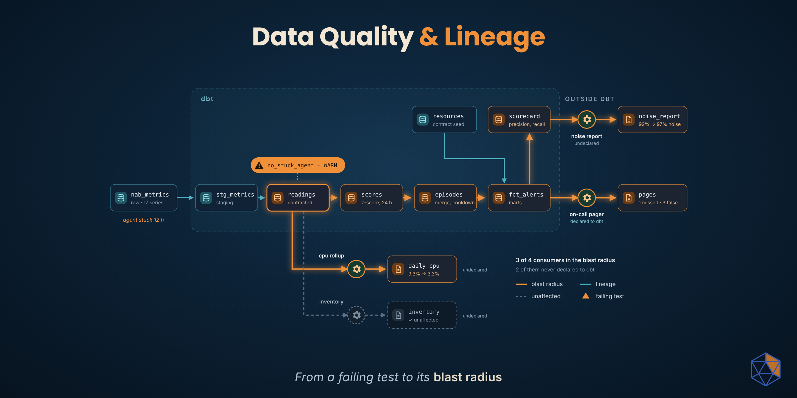

# data-quality-and-lineage



**From a failing data quality test to its blast radius.**

A data quality test tells you something is wrong. Lineage tells you what that
wrong thing has reached, and who relies on it. Most teams have the first and
treat the second as a diagram. This repo works one incident from the moment a
test fires to a blast radius you can act on, widening the view one step at a
time: inside the transformation tool first, then across tool boundaries, then
against evidence.

| | Data quality | Lineage |
|---|---|---|
| Question | Is this data wrong? | What has it reached, and who relies on that? |
| Unit | rows, columns | datasets, columns, jobs, consumers |
| Output | a failing test | a blast radius |

## The stack, and why it is only one option

**dbt** with **dbt-expectations** for the tests, dbt's own **artifacts and
exposures** for the first triage, **OpenLineage** for lineage that crosses tool
boundaries, and **Marquez** as the lineage backend. It is one coherent,
open-source way to do this, not the only one: Great Expectations, Soda,
OpenMetadata, DataHub and most commercial platforms can produce the same shape
of answer. The tools are interchangeable. The order of the triage is the point.

## The system

Seventeen real AWS CloudWatch metric series (EC2 CPU, disk and network; ELB;
RDS; an autoscaling group) from the
[Numenta Anomaly Benchmark](https://github.com/numenta/NAB), at 5-minute
resolution, with hand-labelled anomaly windows as ground truth.

```
data/nab (pinned) ─► raw ─► staging ─► contracted readings ─► scores ─► alert episodes ─► alerts ─► on-call pager
                                              │                                              │
                                              ├─► daily CPU rollup                           └─► scorecard ─► noise report
                                              └─► resource inventory
```

An anomaly detector scores every reading against its trailing 24 hours and
pages on-call. Four consumers read the warehouse from outside dbt; only one of
them, the pager, is declared to dbt.

## The incident

A metrics agent hangs and keeps re-sending its last value, 2.332 % CPU, for
twelve hours. Through that window the real host spikes to 60-70 % CPU, an
incident NAB labels. Nothing looks missing: readings keep arriving on time,
every value is in range. One test, the stuck-agent check, raises a warning, so
the build succeeds and the bad readings flow on.

The page for the real incident never fires. Over the next 24 hours, with its
baseline distorted, the detector pages on-call three times for nothing.

## Walkthrough

Every step is a command and something to look at. Each stage starts where the
previous one ran out of answers.

### Setup

Requirements: [uv](https://docs.astral.sh/uv/) and Docker (for Marquez only).
Commands are bash; on Windows use Git Bash. Run everything from the repo root.

```bash
uv sync
export DBT_PROJECT_DIR=transform DBT_PROFILES_DIR=transform OPENLINEAGE_NAMESPACE=monitoring
uv run dbt deps
docker compose up -d                 # Marquez: API :5000, UI http://localhost:3000
```

The dataset is already pinned in `data/nab/` (NAB at a fixed commit, with
checksums in `MANIFEST.json`). `ingest/fetch_nab.py` is how it got there.

### 1. Profile before you test

```bash
uv run python ingest/load_warehouse.py
uv run python profiling/profile_raw.py
```

No threshold is assumed. The profile (`profiling/reports/raw_profile.md`)
decides them, and finds a real defect in the source before any test exists:
on the 2014 daylight-saving switch, a whole hour of readings is stamped
`03:00:00` on two series. Every decision that follows is recorded, with its
evidence, in [`profiling/DECISIONS.md`](profiling/DECISIONS.md).

### 2. A tested pipeline and a measured alerting baseline

```bash
uv run dbt-ol build --project-dir transform --profiles-dir transform    # PASS=19
uv run python profiling/tune_detector.py
```

- `transform/seeds/series_catalog.csv` is the data contract per series: unit,
  physical bounds, whether a constant value is suspicious.
- The tests live on `int_metrics__contracted`. Structural tests stop the build;
  behavioural ones (silence, stuck agent) warn, because one bad agent should
  not halt monitoring for the whole fleet.
- `profiling/reports/detector_tuning.md` measures the alerting trade-off
  before any setting is chosen. The baseline already shows the fatigue
  problem: about 20 pages a day, 83 % of them outside a labelled incident.

Then run the consumers and keep a copy of what they produce on clean data:

```bash
for c in notify_oncall oncall_noise_report daily_cpu_rollup resource_inventory; do uv run python consumers/$c.py; done
uv run python triage/verify_blast_radius.py snapshot
```

### 3. The incident

```bash
uv run python ingest/load_warehouse.py
uv run python scenarios/stuck_agent.py
uv run dbt-ol build --project-dir transform --profiles-dir transform    # PASS=18 WARN=1
for c in notify_oncall oncall_noise_report daily_cpu_rollup resource_inventory; do uv run python consumers/$c.py; done
```

`no_stuck_agent_over_2h` warns with 122 rows. Everything else passes.

### 4. Triage inside dbt

```bash
uv run python triage/dbt_blast_radius.py
```

From the artifacts dbt writes on every run, plus the failing rows it stored:
which test is the root, which series and time range are bad (stuck since 03:37,
two hours before the test could tell), which downstream models and rows are
touched, and which declared consumer received what: the on-call pager, three
false pages.

It also states where dbt's view ends:

- **time**: a score looks back 24 hours, which no DAG records;
- **absence**: the page that should have been sent leaves no row to find;
- **columns**: model-to-model lineage cannot say which columns a model reads;
- **undeclared consumers**: anything outside dbt that nobody wrote down.

### 5. Triage across tool boundaries

```bash
uv run python triage/lineage_blast_radius.py
```

Every job reported its own lineage as OpenLineage events: dbt through
`dbt-ol`, ingestion and the consumers through `lineage/emit.py`. Marquez holds
the combined graph (open http://localhost:3000, namespace `monitoring`). The
triage asks two questions of it:

- **table-level**: which consumers sit downstream of the table the test failed
  on? All four.
- **column-level**: which columns are computed from the bad column? Those of
  the pager and the daily rollup only.

The two views disagree on two consumers, in opposite directions.

### 6. Settle it with evidence

```bash
uv run python triage/verify_blast_radius.py compare
```

| consumer | declared to dbt | table-level | column-level | actually changed |
|---|---|---|---|---|
| `notify_oncall` | yes | affected | affected | **yes**: real page gone, 3 false pages |
| `daily_cpu_rollup` | no | affected | affected | **yes**: 17 Feb average 3.3 % instead of 9.3 % |
| `oncall_noise_report` | no | affected | not affected | **yes**: fe7f93 now 97 % noise instead of 92 % |
| `resource_inventory` | no | affected | not affected | no |

Table-level lineage over-reports: the inventory only reads identity columns.
Column-level lineage under-reports: which pages exist depends on the bad
column through a filter and a count, which column lineage does not follow.
Each view is wrong in a predictable direction; read together, and settled by
evidence, they are right.

## What made the lineage trustworthy

Lineage is only as good as what the jobs report. Each of these is in the repo
and explained in `profiling/DECISIONS.md` (D10-D12):

- Failing tests store the whole failing row, not a boolean
  (`transform/macros/triageable_expression_is_true.sql`).
- Every test names the column it protects (`meta.checks_column`).
- Every model lists its columns explicitly and documents them; `select *` and
  undocumented columns hide column lineage.
- Code outside dbt reports lineage under exactly the dataset names dbt uses
  (`lineage/emit.py`), so the graph is one graph.

## Repo layout

```
ingest/       pin NAB at a commit; load it verbatim into DuckDB (raw)
data/nab/     the pinned dataset and its manifest (committed)
profiling/    raw profile, detector tuning, and DECISIONS.md
transform/    dbt: staging -> intermediate -> marts, contract seed, tests, exposure
scenarios/    the stuck-agent fault, injected upstream in raw
consumers/    four jobs outside dbt that read the warehouse and report lineage
lineage/      OpenLineage emitter for code outside dbt
triage/       stage 2 (dbt), stage 3 (across tools), stage 4 (evidence)
docker-compose.yml, openlineage.yml   Marquez, and where events go
```

Reset at any time with `uv run python ingest/load_warehouse.py`; clear the
lineage history with `docker compose down -v`.

## Data and licence

Metric series and anomaly labels: [Numenta Anomaly Benchmark](https://github.com/numenta/NAB)
(MIT), pinned to commit `ea702d7`.
